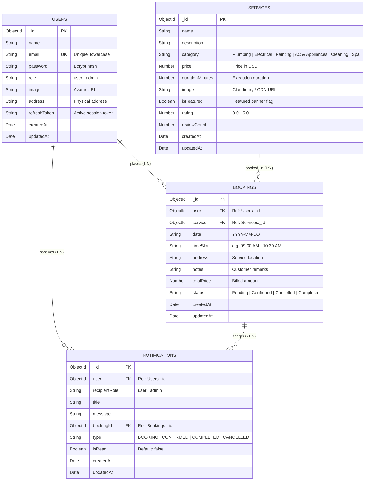

# ServicePro — Backend API & Database Documentation (`service_pro_backend`)

RESTful backend server built with **Node.js**, **Express.js (v5)**, **MongoDB (Mongoose v9)**, **JWT Dual-Token Authentication**, **Cloudinary Media Storage**, and **Google Gemini AI** (`@google/genai`) to power the ServicePro Cross-Platform Mobile Application and Web Admin Control Center.

---

## 1. Tech Stack & Architecture Overview

- **Runtime & Framework:** Node.js v18+, Express.js 5.3
- **Database & ODM:** MongoDB Atlas / Local MongoDB with Mongoose 9.12
- **Authentication & Security:**
  - Dual-Token JWT Architecture (15-min Access Token / 1-day for admin, 7-day Refresh Token)
  - `bcryptjs` password hashing with salt rounds
  - Role-Based Access Control (`user` vs `admin`) with middleware guards (`protect`, `adminOnly`)
  - CORS, JSON body parsers, URL-encoded parsers
- **Cloud Media Storage:** Cloudinary (`multer` + `multer-storage-cloudinary`), 5MB file cap, image format whitelist (`jpg`, `jpeg`, `png`, `webp`)
- **Artificial Intelligence:** Google Gemini AI (`@google/genai`) — Server-side catalog grounding with dynamic Flash model failover and in-memory caching
- **Base URL:** `http://localhost:5000/api`

---

## 2. Installation & Setup Instructions

### 2.1 Prerequisites

- **Node.js:** v18.0.0 or higher
- **MongoDB:** MongoDB Atlas cloud cluster URI or local MongoDB instance running on `mongodb://localhost:27017/service_pro`
- **Cloudinary Account:** Cloud name, API key, and API secret
- **Google Gemini API Key:** From Google AI Studio

### 2.2 Step-by-Step Installation

```bash
# 1. Clone or open the backend directory
cd service_pro_backend

# 2. Install all dependencies
npm install

# 3. Create your environment file from the template
cp .env.example .env
```

### 2.3 Environment Variables Reference (`.env`)

| Key                     | Description                           | Example / Default                                                 |
| ----------------------- | ------------------------------------- | ----------------------------------------------------------------- |
| `PORT`                  | Server listening port                 | `5000`                                                            |
| `MONGODB_URI`           | MongoDB Atlas / Local URI             | `mongodb+srv://<user>:<password>@cluster.mongodb.net/service_pro` |
| `JWT_SECRET`            | Secret key for signing Access Tokens  | `your_access_token_secret`                                        |
| `JWT_REFRESH_SECRET`    | Secret key for signing Refresh Tokens | `your_refresh_token_secret`                                       |
| `GEMINI_API_KEY`        | Google Gemini API Key                 | `AIzaSy...`                                                       |
| `GEMINI_MODEL`          | Default Gemini AI model               | `gemini-3.5-flash-lite`                                           |
| `CLOUDINARY_CLOUD_NAME` | Cloudinary cloud identifier           | `your_cloud_name`                                                 |
| `CLOUDINARY_API_KEY`    | Cloudinary public API key             | `your_api_key`                                                    |
| `CLOUDINARY_API_SECRET` | Cloudinary secret authorization key   | `your_api_secret`                                                 |

### 2.4 Database Auto-Provisioning & Manual Seeding

Upon server start (`server.js`), the application automatically verifies:

1. **Default Administrator:** If no admin exists, it creates:
   - **Email:** `admin@servicepro.com`
   - **Password:** `admin123`
   - **Role:** `admin`
2. **Default Service Catalog:** If the catalog is empty, it automatically seeds 12 standard services across 6 categories (Plumbing, Electrical, Painting, AC & Appliances, Cleaning, Spa).

To run manual seeding independently:

```bash
npm run seed
```

### 2.5 Running the Server

```bash
# Development mode with nodemon hot-reload
npm run dev

# Production startup
npm start
```

Healthcheck endpoint:

```http
GET http://localhost:5000/
```

Response:

```json
{
  "success": true,
  "message": "API is running..."
}
```

---

## 3. Database Schema & Entity-Relationship (ER) Architecture

### 3.1 Entity-Relationship (ER) Diagram



### 3.2 Collections & Data Dictionary

#### 1. `users` Collection (`models/User.js`)

| Field                     | Type     | Constraint                             | Description                           |
| ------------------------- | -------- | -------------------------------------- | ------------------------------------- |
| `_id`                     | ObjectId | Primary Key                            | Unique user identifier                |
| `name`                    | String   | Required, Trimmed                      | Full customer / admin name            |
| `email`                   | String   | Required, Unique, Lowercase            | Login email address                   |
| `password`                | String   | Required                               | Bcrypt salted hashed password         |
| `role`                    | String   | Enum (`user`, `admin`), Default `user` | Role-based authorization              |
| `image`                   | String   | Default `""`                           | Profile photo URL                     |
| `address`                 | String   | Default `""`                           | Default physical street/city address  |
| `refreshToken`            | String   | Default `""`                           | Active JWT refresh token for rotation |
| `createdAt` / `updatedAt` | Date     | Auto timestamps                        | Record creation / update timestamps   |

#### 2. `services` Collection (`models/Service.js`)

| Field                     | Type     | Constraint            | Description                               |
| ------------------------- | -------- | --------------------- | ----------------------------------------- |
| `_id`                     | ObjectId | Primary Key           | Unique service identifier                 |
| `name`                    | String   | Required, Trimmed     | Title of service offering                 |
| `description`             | String   | Required, Trimmed     | Service scope and details                 |
| `category`                | String   | Required, Trimmed     | Category (`Plumbing`, `Electrical`, etc.) |
| `price`                   | Number   | Required, Min 0       | Base rate in USD ($)                      |
| `durationMinutes`         | Number   | Required, Min 1       | Estimated duration in minutes             |
| `image`                   | String   | Default `""`          | Cover photo URL                           |
| `isFeatured`              | Boolean  | Default `false`       | Highlighted on mobile homepage banner     |
| `rating`                  | Number   | Default `4.5` (0 - 5) | Average customer rating                   |
| `reviewCount`             | Number   | Default `0`           | Total user reviews                        |
| `createdAt` / `updatedAt` | Date     | Auto timestamps       | Mongoose timestamps                       |

#### 3. `bookings` Collection (`models/Booking.js`)

| Field                     | Type     | Constraint                                              | Description                              |
| ------------------------- | -------- | ------------------------------------------------------- | ---------------------------------------- |
| `_id`                     | ObjectId | Primary Key                                             | Unique booking identifier                |
| `user`                    | ObjectId | Ref: `User`, Required                                   | Customer placing the booking             |
| `service`                 | ObjectId | Ref: `Service`, Required                                | Booked service                           |
| `date`                    | String   | Required, Trimmed                                       | Scheduled date in format `YYYY-MM-DD`    |
| `timeSlot`                | String   | Required, Trimmed                                       | Booked slot (e.g. `09:00 AM - 10:30 AM`) |
| `address`                 | String   | Required, Trimmed                                       | Customer location for service delivery   |
| `notes`                   | String   | Default `""`                                            | Special instructions from customer       |
| `totalPrice`              | Number   | Required                                                | Billed service charge                    |
| `status`                  | String   | Enum (`Pending`, `Confirmed`, `Cancelled`, `Completed`) | Current appointment status               |
| `createdAt` / `updatedAt` | Date     | Auto timestamps                                         | Booking timestamps                       |

#### 4. `notifications` Collection (`models/Notification.js`)

| Field                     | Type     | Constraint                             | Description                    |
| ------------------------- | -------- | -------------------------------------- | ------------------------------ |
| `_id`                     | ObjectId | Primary Key                            | Unique notification identifier |
| `user`                    | ObjectId | Ref: `User`, Required                  | Recipient user                 |
| `recipientRole`           | String   | Enum (`user`, `admin`), Default `user` | Target audience filter         |
| `title`                   | String   | Required                               | Notification headline          |
| `message`                 | String   | Required                               | Detailed notification content  |
| `bookingId` / `booking`   | ObjectId | Ref: `Booking`, Optional               | Related booking document       |
| `type`                    | String   | Default `BOOKING`                      | Classification type            |
| `isRead`                  | Boolean  | Default `false`                        | Read status indicator          |
| `createdAt` / `updatedAt` | Date     | Auto timestamps                        | Timestamp                      |

---

## 4. RESTful API Endpoint Documentation

### 4.1 Authentication APIs (`/api/auth`)

#### 1. Register User

- **Method & Route:** `POST /api/auth/register`
- **Access:** Public
- **Request Body:**
  ```json
  {
    "name": "Tanvir Hasan",
    "email": "tanvir@example.com",
    "password": "mypassword123"
  }
  ```
- **Response (201 Created):**
  ```json
  {
    "success": true,
    "accessToken": "eyJhbGciOiJIUzI1NiIsIn...",
    "refreshToken": "eyJhbGciOiJIUzI1NiIsIn...",
    "user": {
      "_id": "673b5f12e847c92b5120aa11",
      "name": "Tanvir Hasan",
      "email": "tanvir@example.com",
      "image": "",
      "address": ""
    }
  }
  ```

#### 2. User Login

- **Method & Route:** `POST /api/auth/login`
- **Access:** Public
- **Request Body:**
  ```json
  {
    "email": "tanvir@example.com",
    "password": "mypassword123"
  }
  ```
- **Response (200 OK):**
  ```json
  {
    "success": true,
    "accessToken": "eyJhbGciOiJIUzI1NiIsIn...",
    "refreshToken": "eyJhbGciOiJIUzI1NiIsIn...",
    "user": {
      "_id": "673b5f12e847c92b5120aa11",
      "name": "Tanvir Hasan",
      "email": "tanvir@example.com",
      "image": "",
      "address": "Banani, Dhaka"
    }
  }
  ```

#### 3. Refresh Access Token

- **Method & Route:** `POST /api/auth/refresh-token`
- **Access:** Public
- **Request Body:**
  ```json
  {
    "refreshToken": "eyJhbGciOiJIUzI1NiIsIn..."
  }
  ```
- **Response (200 OK):**
  ```json
  {
    "success": true,
    "accessToken": "eyJhbGciOiJIUzI1NiIsIn..."
  }
  ```

#### 4. Logout User

- **Method & Route:** `POST /api/auth/logout`
- **Access:** Private (`Authorization: Bearer <accessToken>`)
- **Response (200 OK):**
  ```json
  {
    "success": true,
    "message": "Logged out successfully"
  }
  ```

---

### 4.2 User Profile APIs (`/api/users`)

_All routes require header: `Authorization: Bearer <accessToken>`_

#### 1. Get Current User Profile

- **Method & Route:** `GET /api/users/me`
- **Response (200 OK):**
  ```json
  {
    "success": true,
    "user": {
      "_id": "673b5f12e847c92b5120aa11",
      "name": "Tanvir Hasan",
      "email": "tanvir@example.com",
      "role": "user",
      "image": "https://res.cloudinary.com/.../avatar.jpg",
      "address": "House 12, Road 4, Dhanmondi, Dhaka",
      "createdAt": "2026-11-18T12:00:00.000Z",
      "updatedAt": "2026-11-18T14:30:00.000Z"
    }
  }
  ```

#### 2. Edit User Profile

- **Method & Route:** `PUT /api/users/edit-profile`
- **Request Body:**
  ```json
  {
    "name": "Tanvir Hasan Chowdhury",
    "image": "https://res.cloudinary.com/.../new-photo.jpg",
    "address": "Gulshan 2, Dhaka 1212"
  }
  ```
- **Response (200 OK):**
  ```json
  {
    "success": true,
    "message": "Profile updated successfully",
    "user": {
      "_id": "673b5f12e847c92b5120aa11",
      "name": "Tanvir Hasan Chowdhury",
      "email": "tanvir@example.com",
      "image": "https://res.cloudinary.com/.../new-photo.jpg",
      "address": "Gulshan 2, Dhaka 1212",
      "createdAt": "2026-11-18T12:00:00.000Z",
      "updatedAt": "2026-11-18T15:00:00.000Z"
    }
  }
  ```

#### 3. Change Password

- **Method & Route:** `PUT /api/users/change-password`
- **Request Body:**
  json
  {
  "currentPassword": "mypassword123",
  "newPassword": "newSecretPassword456",
  "confirmPassword": "newSecretPassword456"
  }

  ```

  ```

- **Response (200 OK):**
  ```json
  {
    "success": true,
    "message": "Password updated successfully"
  }
  ```

---

### 4.3 Service Catalog APIs (`/api/services`)

#### 1. Get Services (Grouped, Filtered & Paginated)

- **Method & Route:** `GET /api/services`
- **Access:** Public
- **Query Parameters:**
  - `search` (string) — Matches name or description (case-insensitive regex)
  - `category` (string) — Filter by specific category
  - `featured` (boolean) — `true` to return only featured services
  - `page` (number, default: 1) — Page number
  - `limit` (number, default: 6) — Number of records per page
- **Response (200 OK):**
  ```json
  {
    "success": true,
    "count": 2,
    "pagination": {
      "currentPage": 1,
      "limit": 6,
      "totalServices": 12,
      "totalPages": 2,
      "hasNextPage": true,
      "hasPrevPage": false
    },
    "data": [
      {
        "category": "Plumbing",
        "services": [
          {
            "_id": "673b5f12e847c92b5120bb01",
            "name": "Emergency Pipe Leak & Burst Repair",
            "description": "Rapid response leak detection and repair...",
            "category": "Plumbing",
            "price": 45,
            "durationMinutes": 60,
            "image": "https://images.unsplash.com/...",
            "rating": 4.7,
            "reviewCount": 138,
            "isFeatured": true
          }
        ]
      }
    ],
    "services": []
  }
  ```

#### 2. Get Single Service by ID

- **Method & Route:** `GET /api/services/:id`
- **Access:** Public
- **Response (200 OK):**
  ```json
  {
    "success": true,
    "service": {
      "_id": "673b5f12e847c92b5120bb01",
      "name": "Emergency Pipe Leak & Burst Repair",
      "description": "Rapid response leak detection...",
      "category": "Plumbing",
      "price": 45,
      "durationMinutes": 60,
      "image": "https://images.unsplash.com/...",
      "rating": 4.7,
      "reviewCount": 138,
      "isFeatured": true
    }
  }
  ```

---

### 4.4 Booking Engine APIs (`/api/bookings`)

_All booking routes require `Authorization: Bearer <accessToken>`_

#### 1. Check Available Time Slots

- **Method & Route:** `GET /api/bookings/available-slots`
- **Query Parameters:**
  - `serviceId` (ObjectId, required)
  - `date` (string `YYYY-MM-DD`, required)
- **Response (200 OK):**
  ```json
  {
    "success": true,
    "serviceId": "673b5f12e847c92b5120bb01",
    "date": "2026-11-20",
    "allSlots": [
      "09:00 AM - 10:30 AM",
      "10:30 AM - 12:00 PM",
      "12:00 PM - 01:30 PM",
      "02:00 PM - 03:30 PM",
      "03:30 PM - 05:00 PM",
      "05:00 PM - 06:30 PM"
    ],
    "bookedSlots": ["10:30 AM - 12:00 PM"],
    "availableSlots": [
      "09:00 AM - 10:30 AM",
      "12:00 PM - 01:30 PM",
      "02:00 PM - 03:30 PM",
      "03:30 PM - 05:00 PM",
      "05:00 PM - 06:30 PM"
    ]
  }
  ```

#### 2. Create New Booking

- **Method & Route:** `POST /api/bookings`
- **Features:** Double-booking prevention (checks active bookings for same service/date/slot), auto-dispatches in-app notification to all administrators.
- **Request Body:**
  ```json
  {
    "serviceId": "673b5f12e847c92b5120bb01",
    "date": "2026-11-20",
    "timeSlot": "02:00 PM - 03:30 PM",
    "address": "Apartment 4B, Sector 7, Uttara, Dhaka",
    "notes": "Please bring extra piping seals.",
    "totalPrice": 45
  }
  ```
- **Response (201 Created):**
  ```json
  {
    "success": true,
    "message": "Booking created successfully",
    "booking": {
      "_id": "673b6103e847c92b5120cc44",
      "user": {
        "_id": "673b5f12e847c92b5120aa11",
        "name": "Tanvir Hasan",
        "email": "tanvir@example.com",
        "address": "Apartment 4B, Sector 7, Uttara, Dhaka"
      },
      "service": {
        "_id": "673b5f12e847c92b5120bb01",
        "name": "Emergency Pipe Leak & Burst Repair",
        "category": "Plumbing",
        "price": 45
      },
      "date": "2026-11-20",
      "timeSlot": "02:00 PM - 03:30 PM",
      "address": "Apartment 4B, Sector 7, Uttara, Dhaka",
      "notes": "Please bring extra piping seals.",
      "totalPrice": 45,
      "status": "Pending",
      "createdAt": "2026-11-18T16:45:00.000Z"
    }
  }
  ```

#### 3. Get User Bookings

- **Method & Route:** `GET /api/bookings/my-bookings`
- **Query Parameters:**
  - `type` (`upcoming` | `previous`)
  - `status` (`Pending` | `Confirmed` | `Completed` | `Cancelled`)
- **Response (200 OK):**
  ```json
  {
    "success": true,
    "count": 1,
    "bookings": []
  }
  ```

#### 4. Get Booking by ID

- **Method & Route:** `GET /api/bookings/:id`
- **Access:** Private (Only the owner user can view)
- **Response (200 OK):**
  ```json
  {
    "success": true,
    "booking": {}
  }
  ```

#### 5. Cancel Booking

- **Method & Route:** `PATCH /api/bookings/:id/cancel`
- **Rule:** Permitted strictly when status is `Pending`.
- **Response (200 OK):**
  ```json
  {
    "success": true,
    "message": "Booking cancelled successfully",
    "booking": {}
  }
  ```

---

### 4.5 AI Assistant APIs (`/api/ai`)

_Requires `Authorization: Bearer <accessToken>`_

#### Smart AI Customer Assistant

- **Method & Route:** `POST /api/ai/chat`
- **Features:** Server-side grounding on active MongoDB services, automatic fallback across Gemini Flash models, in-memory model caching for fast response.
- **Request Body:**
  ```json
  {
    "message": "My split AC is not blowing cold air. Which service is recommended?"
  }
  ```
- **Response (200 OK):**
  ```json
  {
    "success": true,
    "reply": "I recommend booking our 'Split & Window AC Jet Wash & Gas Top-up' under the AC & Appliances category! The price is $50 and it takes approximately 90 minutes. Our technician will clean the coils, perform high-pressure jet washing, and inspect refrigerant gas."
  }
  ```

---

### 4.6 Notifications APIs (`/api/notifications`)

_Requires `Authorization: Bearer <accessToken>`_

#### 1. Get Notification Feed

- **Method & Route:** `GET /api/notifications`
- **Access:** User (sees own notifications) / Admin (sees admin broadcast + personal notifications)
- **Response (200 OK):**
  ```json
  {
    "success": true,
    "unreadCount": 1,
    "notifications": [
      {
        "_id": "673b621ae847c92b5120dd55",
        "user": "673b5f12e847c92b5120aa11",
        "recipientRole": "user",
        "title": "Booking Confirmed! 🚀",
        "message": "Your booking for 'Emergency Pipe Leak & Burst Repair' has been confirmed.",
        "bookingId": "673b6103e847c92b5120cc44",
        "type": "CONFIRMED",
        "isRead": false,
        "createdAt": "2026-11-18T17:00:00.000Z"
      }
    ]
  }
  ```

#### 2. Mark All Notifications as Read

- **Method & Route:** `PATCH /api/notifications/read-all`
- **Response (200 OK):**
  ```json
  {
    "success": true,
    "message": "All notifications marked as read"
  }
  ```

#### 3. Mark Single Notification as Read

- **Method & Route:** `PATCH /api/notifications/:id/read`
- **Response (200 OK):**
  ```json
  {
    "success": true,
    "message": "Notification marked as read",
    "notification": {}
  }
  ```

---

### 4.7 Admin Control APIs (`/api/admin`)

_All admin management routes require `Authorization: Bearer <adminToken>` with `role: 'admin'`_

#### 1. Admin Login

- **Method & Route:** `POST /api/admin/login`
- **Access:** Public
- **Request Body:**
  ```json
  {
    "email": "admin@servicepro.com",
    "password": "admin123"
  }
  ```
- **Response (200 OK):**
  ```json
  {
    "success": true,
    "message": "Admin login successful",
    "accessToken": "eyJhbGciOiJIUzI1NiIsIn...",
    "refreshToken": "eyJhbGciOiJIUzI1NiIsIn...",
    "admin": {
      "id": "673b5e40e847c92b51209999",
      "name": "Sabbir Molla",
      "email": "admin@servicepro.com",
      "role": "admin"
    }
  }
  ```

#### 2. Get Admin Dashboard Metrics

- **Method & Route:** `GET /api/admin/dashboard`
- **Response (200 OK):**
  ```json
  {
    "success": true,
    "kpis": {
      "totalBookings": 48,
      "pendingCount": 5,
      "confirmedCount": 12,
      "completedCount": 28,
      "cancelledCount": 3,
      "grossRevenue": 3420,
      "totalRevenue": 3420,
      "fulfilledRate": 58
    },
    "catalogStats": {
      "totalServices": 12,
      "categoryDistribution": [
        { "category": "Plumbing", "count": 2, "sharePercent": 17 },
        { "category": "Electrical", "count": 2, "sharePercent": 17 }
      ],
      "categoryCounts": {
        "Plumbing": 2,
        "Electrical": 2,
        "Painting": 2,
        "AC & Appliances": 2,
        "Cleaning": 2,
        "Spa": 2
      }
    },
    "recentPendingBookings": []
  }
  ```

#### 3. Get Revenue & Pipeline Analytics

- **Method & Route:** `GET /api/admin/analytics`
- **Query Parameters:** `range` (`7d` [default] or `30d`)
- **Response (200 OK):**
  ```json
  {
    "success": true,
    "range": "7d",
    "revenueAnalytics": {
      "cycleVolume": 1850,
      "averageTicket": 55,
      "peakDayRate": 420,
      "labels": ["Wed", "Thu", "Fri", "Sat", "Sun", "Mon", "Today"],
      "revenues": [120, 310, 240, 180, 290, 290, 420]
    },
    "fulfillmentPipeline": {
      "fulfilledPercent": 85,
      "totalBookings": 34,
      "completedCount": 20,
      "confirmedCount": 9,
      "pendingCount": 3,
      "cancelledCount": 2,
      "breakdown": {
        "completed": { "count": 20, "percent": 59 },
        "confirmed": { "count": 9, "percent": 26 },
        "pending": { "count": 3, "percent": 9 },
        "cancelled": { "count": 2, "percent": 6 }
      }
    }
  }
  ```

#### 4. Get Admin Service Catalog

- **Method & Route:** `GET /api/admin/services`
- **Query Parameters:** `category` (`All` or specific category), `search` (keyword)
- **Response (200 OK):**
  ```json
  {
    "success": true,
    "count": 12,
    "services": []
  }
  ```

#### 5. Create Service

- **Method & Route:** `POST /api/admin/services`
- **Content-Type:** `multipart/form-data` or `application/json`
- **Payload Fields:**
  - `name` (string, required)
  - `description` (string, required)
  - `category` (string, required)
  - `price` (number, required)
  - `durationMinutes` (number, optional, default: 60)
  - `imageFile` (file, optional — uploaded directly to Cloudinary)
  - `image` / `imageUrl` (string, optional — used if no file is uploaded)
  - `isFeatured` (boolean, optional)
- **Response (201 Created):**
  ```json
  {
    "success": true,
    "message": "Service created successfully",
    "service": {}
  }
  ```

#### 6. Update Service

- **Method & Route:** `PUT /api/admin/services/:id`
- **Content-Type:** `multipart/form-data` or `application/json`
- **Response (200 OK):**
  ```json
  {
    "success": true,
    "message": "Service updated successfully",
    "service": {}
  }
  ```

#### 7. Delete Service

- **Method & Route:** `DELETE /api/admin/services/:id`
- **Response (200 OK):**
  ```json
  {
    "success": true,
    "message": "Service deleted successfully",
    "service": {}
  }
  ```

#### 8. Get Admin Bookings List (with Filters & Status Counts)

- **Method & Route:** `GET /api/admin/bookings`
- **Query Parameters:**
  - `status` (`All`, `Pending`, `Confirmed`, `Completed`, `Cancelled`)
  - `search` (customer name, email, booking address, service name, or booking ID)
- **Response (200 OK):**
  ```json
  {
    "success": true,
    "count": 10,
    "statusCounts": {
      "All": 48,
      "Pending": 5,
      "Confirmed": 12,
      "Completed": 28,
      "Cancelled": 3
    },
    "bookings": []
  }
  ```

#### 9. Update Booking Status (Confirmed / Completed / Cancelled)

- **Method & Route:** `PATCH /api/admin/bookings/:id/status`
- **Rule:** Automatically creates a real-time In-App Notification record for the customer informing them of the status change.
- **Request Body:**
  ```json
  {
    "status": "Confirmed"
  }
  ```
- **Response (200 OK):**
  ```json
  {
    "success": true,
    "message": "Booking #673b6103e847c92b5120cc44 status updated to 'Confirmed' successfully",
    "booking": {},
    "notification": {
      "_id": "673b6555e847c92b5120ff77",
      "user": "673b5f12e847c92b5120aa11",
      "title": "Booking Confirmed! 🚀",
      "message": "Your booking for 'Emergency Pipe Leak & Burst Repair' on 2026-11-20 (02:00 PM - 03:30 PM) has been confirmed."
    }
  }
  ```

---

## 5. Standard Response Contracts & Error Codes

### Standard Success Response

```json
{
  "success": true,
  "message": "Operation completed successfully",
  "data": {}
}
```

### Standard Error Response

```json
{
  "success": false,
  "message": "Descriptive reason for failure"
}
```

### HTTP Status Codes

| Code  | Status                | Usage                                                                                        |
| ----- | --------------------- | -------------------------------------------------------------------------------------------- |
| `200` | OK                    | Successful GET, PUT, PATCH, DELETE operations                                                |
| `201` | Created               | Successfully created User, Service, or Booking                                               |
| `400` | Bad Request           | Validation errors, missing parameters, double-booking conflicts                              |
| `401` | Unauthorized          | Missing, expired, or invalid JWT bearer token                                                |
| `403` | Forbidden             | Insufficient permissions (non-admin accessing admin route, accessing someone else's booking) |
| `404` | Not Found             | Resource (User, Service, Booking, Notification) does not exist                               |
| `500` | Internal Server Error | Uncaught server exceptions or database errors                                                |
